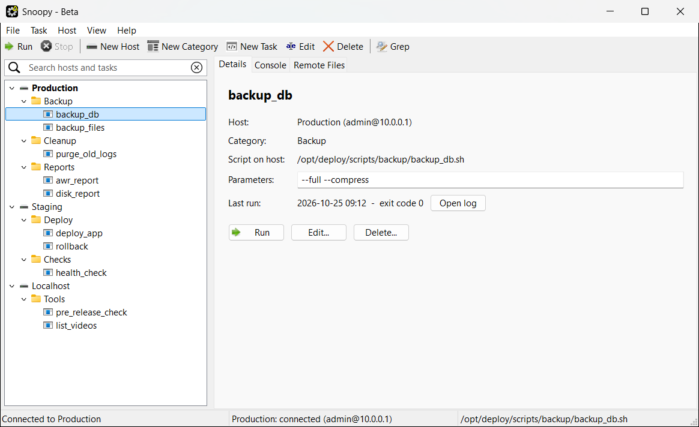
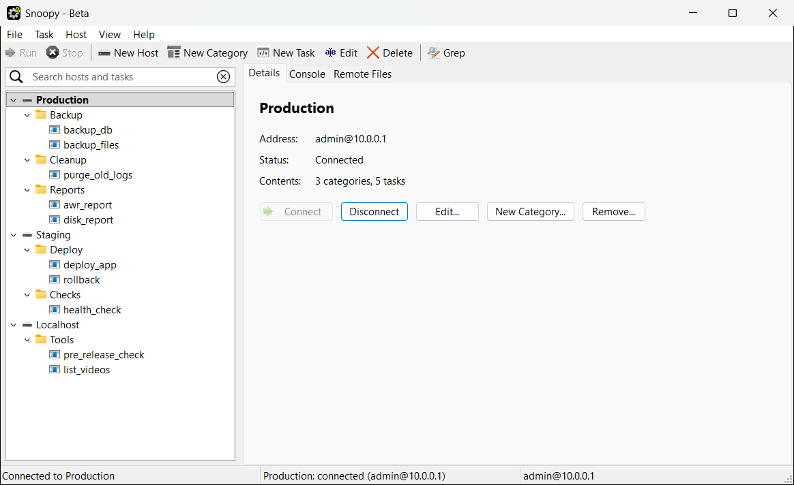
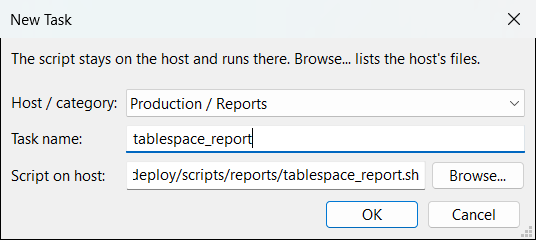
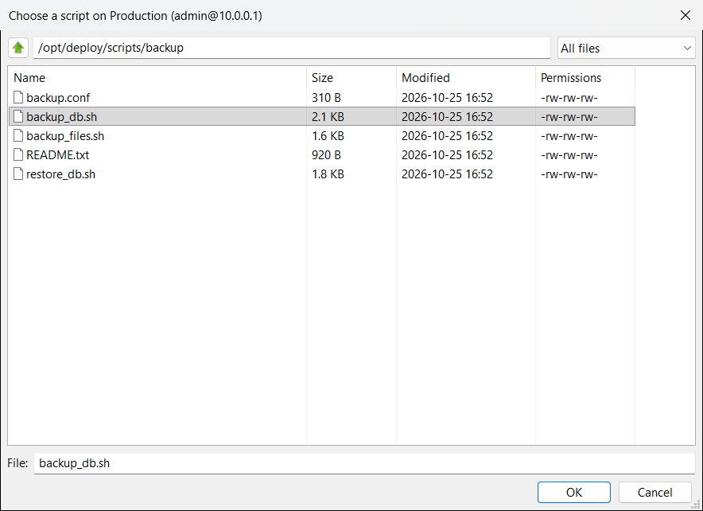
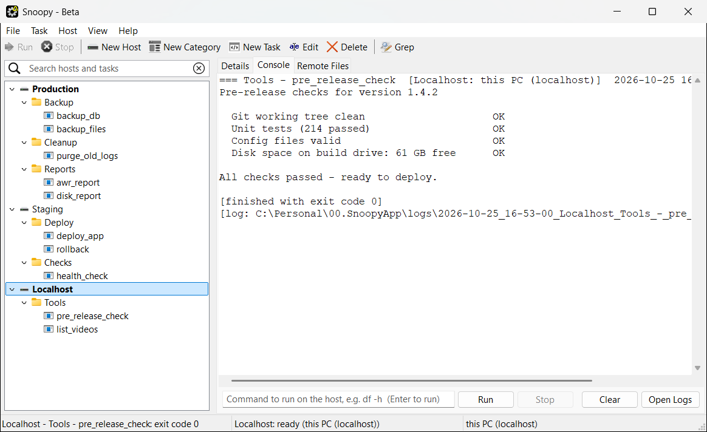
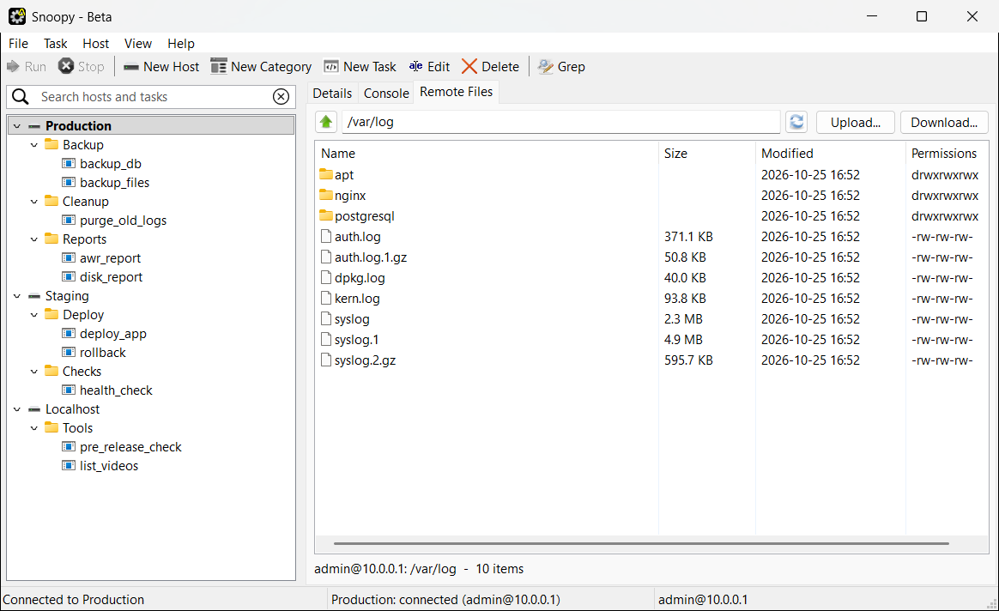

# Snoopy

[](https://github.com/Ramesh-Mokkapati/Snoopy/actions/workflows/ci.yml)

Snoopy is a desktop tool for Windows and Linux for organising deployment and maintenance
scripts and running them on one or more servers. Scripts are grouped by
**host** and **category** in a tree. Pick a task, type its parameters and press
**Run**. Snoopy copies the script to the server over SSH, runs it, streams the
output live and keeps a log of every run.

It can also run scripts on your own PC. It searches files on a server (grep and
zgrep), shows disk usage, runs ad-hoc commands, and lets you browse, upload and
download files.



Built with Python, [wxPython](https://wxpython.org/) and
[Paramiko](https://www.paramiko.org/).

---

## Contents

- [Features](#features)
- [Requirements](#requirements)
- [Installation](#installation)
- [Running Snoopy](#running-snoopy)
- [Getting started](#getting-started)
- [The window](#the-window)
- [Hosts](#hosts)
- [Categories and tasks](#categories-and-tasks)
- [Running tasks and commands](#running-tasks-and-commands)
- [Running scripts on Linux servers](#running-scripts-on-linux-servers)
- [Running on this PC (localhost)](#running-on-this-pc-localhost)
- [Tools](#tools)
- [Keyboard shortcuts](#keyboard-shortcuts)
- [Configuration files](#configuration-files)
- [Logs](#logs)
- [Security](#security)
- [Troubleshooting](#troubleshooting)
- [Project structure](#project-structure)
- [Development and tests](#development-and-tests)
- [Known limitations](#known-limitations)

---

## Features

- **Several hosts in one tree**: Host, then Category, then Task. Each host has its own
  connection, console and file browser, and different hosts can run at the same time.
- **One-click runs of scripts that live on your servers**: pick a script by browsing
  the server, and Snoopy saves its path. **Run** then executes it there over SSH with
  your parameters and shows live output. It remembers the last parameters and
  result of every task.
- **Run on this PC**: hosts at `localhost` / `127.0.0.1` run locally without SSH.
  `.sh` scripts use bash (Git Bash on Windows); on Windows, `.cmd`/`.bat` use cmd.exe
  and `.ps1` uses PowerShell.
- **Console**: run any command on the selected host, and stop it at any time.
- **Remote Files**: browse a host's file system, upload and download files.
- **Tools**: grep, zgrep and disk usage, with simple forms.
- **Logs**: every run is saved to a time-stamped log file.
- **Safe by default**: passwords live in the system keyring (Windows Credential
  Manager, or the desktop keyring on Linux), never in
  config files. SSH host keys are checked, and parameters are shell-quoted.
- **Search** across hosts, categories, tasks and script paths.

## Requirements

| | |
|---|---|
| Operating system | Windows 10/11, or Linux with a graphical desktop (GTK 3) |
| Python | 3.12 or newer |
| Python packages | `wxPython` 4.2 or newer, `paramiko`, `keyring` (see [requirements.txt](requirements.txt)) |
| Remote hosts | Any server with an SSH server and `bash` (typically Linux), with password login allowed |
| Running `.sh` scripts on this PC | Windows: [Git for Windows](https://git-scm.com/download/win) (Git Bash) or WSL. Linux: the system's bash |

**Tested on:**
- **Windows 11:** Python 3.13 and 3.14 with wxPython 4.3.1.
- **Ubuntu 24.04:** Python 3.12 with the distribution's wxPython 4.2.1 (GTK 3).

On both, the full test suite and an end-to-end GUI run pass. That run covers
local and SSH hosts, Stop, SFTP browsing, menus and help.

The SSH tests use a built-in test SSH/SFTP server. On Linux it runs the commands
it receives in real bash, which checks how remote scripts actually behave:
- the starting folder
- `#!` lines
- arguments
- end of input
- exit codes
- `~/` paths

## Installation

### Packaged builds (no Python needed)

Each tagged version is published on the repository's
[Releases page](https://github.com/Ramesh-Mokkapati/Snoopy/releases):

| Download | Run |
|---|---|
| `Snoopy-<version>-windows-x64.zip` | Unzip anywhere and start `Snoopy\Snoopy.exe` |
| `Snoopy-<version>-linux-x64.tar.gz` | `tar -xzf Snoopy-<version>-linux-x64.tar.gz` and start `Snoopy/Snoopy` |

- **Your data stays next to the program.** A packaged Snoopy keeps `Conf/` and
  `logs/` beside the executable. Put the folder somewhere you can write to (not
  `C:\Program Files`), and keep `Conf/` when you upgrade by unpacking the new
  version over the old folder.
- **Windows SmartScreen:** the program isn't code-signed, so SmartScreen may
  warn on first start. Choose *More info → Run anyway*.
- **Linux compatibility:** the build is made on Ubuntu 24.04, so it needs a
  distribution at least that new (glibc 2.39 or later).

To run from source instead, follow the steps below.

### Windows

From the project folder, create a virtual environment and install the packages:

```powershell
py -m venv .venv
.venv\Scripts\activate
python -m pip install -r requirements.txt
```

### Linux

PyPI has no ready-made wxPython builds for Linux (pip would compile it for a long
time), so install wxPython from your distribution. Then let the virtual
environment see it, and install the rest with pip. On Ubuntu or Debian:

```bash
sudo apt install python3-venv python3-wxgtk4.0
python3 -m venv --system-site-packages .venv
.venv/bin/pip install -r requirements.txt
```

`requirements.txt` skips wxPython on Linux for this reason. On other
distributions, install their wxPython package (often `python3-wxpython4`,
version 4.2 or newer).

To **save passwords** on Linux, Snoopy uses the desktop keyring (GNOME Keyring /
KWallet via the Secret Service), which normal desktop installs already have.
Without one, it still works, but asks for each host's password once per session
instead of remembering it.

## Running Snoopy

```powershell
.venv\Scripts\python.exe SnoopyApp.py      # Windows
.venv/bin/python SnoopyApp.py              # Linux
```

Snoopy finds its images and config relative to its own folder, so you can start
it from anywhere. For example, on Windows you can use a desktop shortcut to
`<project>\.venv\Scripts\pythonw.exe` with `<project>\SnoopyApp.py` as the
argument (`pythonw` starts it without a console window).

## Getting started

1. Start Snoopy. With no hosts yet, it says so and shows a welcome page.
2. **Add a host**: choose *File > New Host* (Ctrl+Shift+H). Enter a display name
   (e.g. `Production`), the server's host name or IP, user name, SSH port and
   password. Leave *Test connection after saving* ticked.
3. The first time Snoopy connects to a server, it shows the server's **key
   fingerprint**. Accept it only if it matches the server (ask its administrator
   if unsure).
4. **Add a category**: select the host and choose *New Category*
   (Ctrl+Shift+N), e.g. `Backup`.
5. **Add a task**: select the category and choose *New Task* (Ctrl+N). Give it a
   name, then click **Browse…** to pick the script **on the server** (e.g.
   `/opt/scripts/backup.sh`). Snoopy stores that path in the host's `.ini` file.
6. **Run it**: select the task, type any parameters on the *Details* tab and
   press **Run** (F5). The output appears on the *Console* tab.

To run scripts on your own PC instead, add a host with the address `localhost`
(see [Running on this PC](#running-on-this-pc-localhost)).

## The window


- **Tree (left)**: hosts, their categories and tasks. Connected hosts are shown
  in **bold**. Type in the search box to filter. Right-click any item for its
  actions, and double-click a task to run it.
- **Details tab**: what is selected.
  - *Host*: address, connection state, number of categories and tasks, and
    Connect / Disconnect / Edit / New Category / Remove.
  - *Category*: its host, task count, and New Task / Rename / Delete.
  - *Task*: host, category, script path (a red note appears if the file is
    missing), the **Parameters** box, the last run's time and result with
    **Open log**, and Run / Edit / Delete.
- **Console tab**: the selected host's output. Type a command in the box at the
  bottom and press Enter to run it on that host. **Stop**, **Clear** and
  **Open Logs** are there too. Each host has its own console.
- **Remote Files tab**: the selected host's files (see [Tools](#tools)).
- **Status bar**: what Snoopy is doing, the selected host's connection, and the
  selected script or address.

Toolbar buttons and menu items are greyed out when they don't apply. For
example, *Run* needs a task selected and nothing already running on its host.

## Hosts

| Action | How |
|---|---|
| Add | *File > New Host* (Ctrl+Shift+H), toolbar *New Host*, or right-click empty space in the tree |
| Edit / rename | Select the host, then *Edit* (F2) |
| Connect / disconnect | *Host > Connect / Disconnect*, the buttons on the host's Details page, or right-click |
| Disconnect everything | *Host > Disconnect All* |
| Remove | Select the host, then *Delete*. Its files are kept, renamed to `*.deleted-<date>` |



Each host has:

- **Display name**: what the tree shows. It must be unique. Letters, digits,
  spaces, `.`, `_` and `-` are allowed.
- **Host name or IP**: the server's address. `localhost` / `127.0.0.1` / `::1` mean
  this PC.
- **User name** and **SSH port** (default 22). These are not needed for this PC.
- **Password**: stored in the system keyring (Windows Credential Manager, or the
  desktop keyring on Linux). Leave it empty when editing to keep the saved one.

Snoopy connects when first needed (running a task, opening Remote Files, or
*Connect*) and keeps the connection open until you disconnect or close Snoopy.

## Categories and tasks

- **Category**: a group of tasks within a host, such as `Backup`, `Cleanup` or
  `Reports`. Create, rename or delete one from the toolbar, the menus or by
  right-clicking. Deleting a category removes its tasks from Snoopy, but never
  deletes the script files.
- **Task**: a name plus the path of a script **on that host**.
  - In the task dialog, **Browse…** opens a file picker on the host itself: over
    SFTP for a server, or the normal file dialog for a localhost host.
  - You can also type the path. On a server it must be a full path such as
    `/opt/scripts/backup.sh`, or `~/bin/backup.sh` for one in the SSH user's home
    folder.
  - The *Host / category* list chooses where the task belongs. Pick a different
    one when editing to move the task; its remembered parameters and last
    result move with it. When moving to another host, make sure the script
    exists there too.

  

  

Supported script types:

| Script | On a remote (SSH) host | On this PC (localhost) |
|---|---|---|
| `.sh`, `.py`, … (anything else) | Run in place: directly if executable (its `#!` line picks the interpreter), otherwise with `bash` | Run with bash (Git Bash / WSL on Windows) |
| `.cmd`, `.bat` | Not allowed (Snoopy explains why) | Windows: run with `cmd.exe`. Linux: not allowed |
| `.ps1` | Not allowed | Windows: run with PowerShell. Linux: not allowed |

## Running tasks and commands

**Running a task** (Run button, F5, or double-click):

1. Snoopy saves the parameters you typed; they are filled in next time.
2. On a remote host, Snoopy checks the script exists there, then runs it **in
   place**, starting in the script's own folder (see
   [Running scripts on Linux servers](#running-scripts-on-linux-servers)). Nothing
   is copied to the server.
3. Output (stdout and stderr) streams live to that host's **Console** tab and to a
   log file.
4. The result appears in the console, the status bar and the task's *Last run*
   line.



**Parameters** are split the way a Unix shell would: `-v "two words" x` gives
three arguments. Each one is passed to the script exactly, so characters like
`;`, `&` or `$` cannot inject extra commands.

**Console commands** run on the selected host exactly as typed, for example
`df -h`, `tail -n 50 /var/log/syslog` or `systemctl status nginx`.

**Stopping**: *Stop* (Shift+F5, toolbar, or the Console's Stop button) ends the
selected host's running command. Each host runs one command at a time. Different
hosts can run at the same time, each in its own console.

## Running scripts on Linux servers

This is Snoopy's main use. Your scripts stay **on the Linux servers**, and Snoopy
on your PC keeps a catalogue of them: which host, which category, and the
script's path on that host. It runs them over SSH (Paramiko) with one click.

1. **Add the Linux server as a host**: *File > New Host*. Enter a display name,
   the server's address, your Linux user name, the SSH port (usually 22) and the
   password. Leave *Test connection after saving* ticked, and accept the server's
   key fingerprint the first time.
2. **Add a category and a task** under that host. In the task dialog, click
   **Browse…**. A file picker opens **on the server**: navigate its folders,
   choose the script and press OK. Snoopy stores the remote path, e.g.
   `/opt/scripts/backup/backup_db.sh`, in `Conf/Hosts/<host>.ini`:
   ```ini
   [Backup]
   backup_db = /opt/scripts/backup/backup_db.sh
   ```
3. **Run it**: select the task, type the parameters (e.g. `--full --compress`) and
   press **Run** (F5).

Each time you run the task, Snoopy:
1. Checks that the script still exists on the server. If not, the console says
   *Script not found on <host>: <path>*.
2. Runs it **in place** on the server, from the script's own folder:
   ```bash
   cd -- /opt/scripts/backup && if [ -x backup_db.sh ]; then exec ./backup_db.sh …; else exec bash backup_db.sh …; fi
   ```
   (Simplified; Snoopy quotes the full paths and every argument.)
3. Streams stdout and stderr live to that host's **Console** tab.
4. Saves a log on your PC.

Nothing is copied to the server or left behind.

What the script sees on the server:

| | |
|---|---|
| Interpreter | Its own `#!` line if the file is executable (`chmod +x`), otherwise `bash` |
| Working folder | The script's own folder, so `./helper.sh` or `source ./settings.conf` next to it just work |
| Arguments | `$1`, `$2`, … exactly as you typed them (split like a shell, then passed safely) |
| `$0` | The script's real path on the server |
| User | The host's SSH user name. There's no terminal, so `sudo` only works if that user may run the command without a password |
| Input | None: `read` gets end-of-input immediately, so pass everything as parameters |

**Writing scripts for Snoopy**: fail fast and report clearly, because the exit
code becomes the task's *Last run* result. For example:

```bash
#!/bin/bash
set -euo pipefail                      # stop at the first error
source ./backup.conf                   # found next to this script
target=${1:?usage: backup_db.sh <database> [--compress]}
echo "Backing up $target to $BACKUP_DIR ..."
pg_dump "$target" > "$BACKUP_DIR/$target-$(date +%F).sql"
[ "${2:-}" = "--compress" ] && gzip -f "$BACKUP_DIR/$target-$(date +%F).sql"
echo "Done."
```

Scripts on the server need Unix (LF) line endings. A script saved with Windows
line endings fails with `$'\r': command not found`; fix it on the server with
`dos2unix script.sh` or `sed -i 's/\r$//' script.sh`.

Beyond scripts, the same host gives you ad-hoc commands in the **Console**
(`df -h`, `journalctl -u nginx -n 50`), **Grep / Zgrep / Disk Usage** forms, and
**Remote Files** for browsing, uploading and downloading. See [Tools](#tools).

## Running on this PC (localhost)

A host whose address is `localhost`, `127.0.0.1` or `::1` **does not use SSH**.
There is no connection, password or host-key check; everything runs on this PC:

- `.sh` scripts, console commands, grep and du run in **bash**. On Linux, that's
  the system bash. On Windows, it's Git Bash if installed, otherwise WSL.
- On Windows, `.cmd` / `.bat` scripts run with `cmd.exe`, and `.ps1` scripts with
  PowerShell (`-ExecutionPolicy Bypass`):
  - They run in place, from the script's own folder, as if you double-clicked them.
  - Parameters are quoted so `&`, `|`, `<` and `>` arrive literally; `%` is still
    expanded by cmd.
  - `pause` does not wait, because there is no keyboard to press.
  - They work even without bash.
- On Linux, Windows scripts are refused with an explanation.
- The **Remote Files** tab browses this PC's disk.

## Tools

All tools act on the **selected host** and remember what you entered last time.

| Tool | Shortcut | What it runs |
|---|---|---|
| Grep | Ctrl+G | `grep -n[r][i] -e <pattern> -- <path>`: search text in files (optionally sub-folders and ignoring case) |
| Zgrep | Ctrl+Shift+G | `zgrep -n[i] -e <pattern> -- <files>`: search inside compressed `.gz` files |
| Disk Usage | Ctrl+D | `du -h --max-depth=1 -- <path> \| sort -h` (or `du -sh` for one total) |

Paths may contain simple wildcards such as `/var/log/*.gz`. Anything else is
quoted.

**Remote Files** (Ctrl+3): browse the host over SFTP. Double-click a folder to
open it, or **Up** to go to the parent; you can also type a path. Use
**Upload…** to send files to the current folder, and **Download…** (or
double-click a file) to copy files to this PC. Snoopy asks before overwriting.



## Keyboard shortcuts

| Shortcut | Action |
|---|---|
| F5 | Run the selected task |
| Shift+F5 | Stop the selected host's command |
| Ctrl+N | New task |
| Ctrl+Shift+N | New category |
| Ctrl+Shift+H | New host |
| F2 | Edit the selected item |
| Delete (in the tree) | Delete the selected item |
| Ctrl+F | Search the tree |
| Ctrl+G / Ctrl+Shift+G | Grep / zgrep on the selected host |
| Ctrl+D | Disk usage on the selected host |
| Ctrl+1 / Ctrl+2 / Ctrl+3 | Details / Console / Remote Files tab |
| F1 | Help |

## Configuration files

Snoopy manages these files itself; you rarely need to edit them by hand. All are
plain INI files.

**`Conf/Config.ini`**: the global settings and the list of hosts:

```ini
[Snoopy]
FeedbackEmail = someone@example.com

[Hosts]
Production = Hosts/Production.ini
Localhost = Hosts/Localhost.ini
```

**`Conf/Hosts/<host>.ini`**: one per host: its connection, then one section
per category, each listing `task name = script path`:

```ini
[Host]
HostName = 10.0.0.1
UserName = admin
Port = 22

[Backup]
backup = /opt/scripts/backup/backup.sh
backupDWH = /opt/scripts/backup/backupDWH.sh

[Reports]
create_awr_report = ~/reports/create_awr_report.sh
```

Section names `Host`, `Hosts` and `Snoopy` are reserved. Every other section in a
host file is a category, and each `task = path` line gives the script's path **on
that host**. For a localhost host, that's a path on this PC.

**`Conf/Hosts/<host>.history.ini`**: remembered parameters, last-run results and
tool inputs for that host.

**Global settings**: *File > Settings* sets the **feedback e-mail** address used by
*Help > Send Feedback*, which opens your e-mail program with a pre-filled message.

**Upgrading from the single-host version**: if `Conf/Config.ini` still has a
`[Host]` section, Snoopy converts it on start. The host and its tasks move to
`Conf/Hosts/<HostName>.ini`, `Conf/History.ini` moves with them, the old file is
kept as `Conf/Config.ini.bak`, and a message confirms it.

> The host files contain server addresses, user names and local script paths,
> so [.gitignore](.gitignore) keeps `Conf/Config.ini` and `Conf/Hosts/` out of
> version control. A fresh copy starts with no hosts and creates these files as
> you add them.

## Logs

Every task, command and tool run is written to `logs/` in the project folder.
Files are named `<date>_<time>_<host>_<task or command>.log`. Each log has a
header with the host and time, the full output, the exit code (or *stopped* /
*error*) and its own path.

Open logs with **Open Logs** on the Console tab, or with **Open log** on a
task's Details page for its last run.

## Security

- **Passwords** are never written to Snoopy's files. They are stored in the
  system keyring as `Snoopy:<HostName>` with the user name as the account: Windows
  Credential Manager on Windows, and the desktop keyring (Secret Service) on Linux.
  If there is no keyring, passwords are kept in memory until Snoopy closes. If a
  login fails, the saved password is deleted and you are asked again.
- **Host keys**: the first connection to a server shows its key fingerprint
  (SHA-256) for you to accept. Accepted keys are saved in
  `%APPDATA%\Snoopy\known_hosts` on Windows, or `~/.config/snoopy/known_hosts` on
  Linux. Your normal `~/.ssh/known_hosts` is read too. If a server's key
  **changes**, Snoopy refuses to connect and explains why, since that can
  indicate an interception attempt.
- **Quoting**: script paths, task parameters, and grep, zgrep and du inputs are
  shell-quoted before they are sent. Local commands run without a shell wrapper
  unless bash or cmd is the intended interpreter.
- **Scripts run as the host's SSH user**, with that user's permissions. Snoopy
  never copies or modifies scripts on the server.
- The **Console** command line runs exactly what you type. It is a real shell on
  the host.

## Troubleshooting

| Problem | What to do |
|---|---|
| *Login to … failed* | The saved password was wrong and has been cleared. Enter it again, or set it with *Edit* on the host. Saved passwords appear in the system keyring (Windows Credential Manager, or e.g. Seahorse on Linux) as `Snoopy:<HostName>`. |
| *The host key for … has CHANGED* | If the server was legitimately reinstalled, remove its line from `%APPDATA%\Snoopy\known_hosts` (Windows) or `~/.config/snoopy/known_hosts` (Linux) and connect again. Otherwise, contact its administrator. |
| *Could not connect…* | Check the host name, port and that the server allows SSH password logins. Use *Edit* on the host to fix it. |
| *Script not found on <host>: <path>* | The script was moved, renamed or deleted on the server, or the task points to the wrong host. *Edit* the task and use **Browse…** to pick it again. |
| *Script not found on this PC* | (Localhost hosts.) The script path is wrong or the file was moved. *Edit* the task and pick the file again (a red note on the Details page also shows this). |
| `Permission denied` when running a remote script | The SSH user can't read the script or enter its folder. Fix the permissions on the server, or use a host whose user can. |
| *… is a Windows script, so it can only run on this PC* | `.cmd`, `.bat` and `.ps1` scripts can't run on Linux servers. Move the task to a localhost host, or use a `.sh` script. |
| *bash was not found* | Install [Git for Windows](https://git-scm.com/download/win) (or WSL) to run `.sh` scripts and commands on this PC. |
| *… is a Windows script (.cmd, .bat or .ps1); it can't run on this system* | You're on Linux: use a `.sh` script for that task. |
| *No system keyring found: the password is remembered until Snoopy closes* | Linux without a desktop keyring. Install/enable GNOME Keyring or KWallet to save passwords between sessions; Snoopy works either way. |
| `$'\r': command not found` on a host | The script on the server has Windows (CRLF) line endings. Convert it there: `dos2unix script.sh` or `sed -i 's/\r$//' script.sh`. |
| `…: command not found` on a host | The script uses a command that isn't installed on that host, or not on the PATH of a non-interactive SSH session. Use full paths (e.g. `/usr/sbin/…`) in the script. |
| A task seems stuck | Press **Stop** (Shift+F5). Scripts that wait for keyboard input can't be answered. Pass the values as parameters instead. |
| *Host file not found* / host shown with *(error)* | `Conf/Config.ini` points to a host file that is missing or unreadable. Restore it, or remove the host and add it again. |

## Project structure

```
SnoopyApp.py             Entry point: starts the wx application
requirements.txt         Python dependencies (exact versions)
.github/workflows/ci.yml Build pipeline (GitHub Actions): tests on Windows and Linux
.github/workflows/release.yml  Packaged builds and GitHub Release for each version tag
Snoopy.spec              PyInstaller recipe for the packaged app
requirements-build.txt   Extra dependency for building packages (PyInstaller)
images/                  Icons and splash screen
docs/
  screenshots/             Screenshots used in this README
  make_screenshots.py      Regenerates them from demo data
Conf/                    Configuration (created as you add hosts; not committed)
  Config.ini               Global settings and the list of hosts
  Hosts/                   One .ini (and .history.ini) per host
logs/                    Run logs (created automatically; not committed)
Utils/
  SnoopyWindowMgr.py       Main window: tree, tabs, menus, toolbar, actions
  HostStore.py             Host list, per-host config/history, upgrade from single-host
  RemoteHost.py            SSH connection: run commands and scripts, SFTP, command builders
  LocalHost.py             Same interface for this PC: bash / cmd.exe / PowerShell, local files
  ConsolePanel.py          Console tab (output, command line, Stop/Clear/Open Logs)
  RemoteFilesPanel.py      Remote Files tab (browse, upload, download)
  GUIManager.py            Form dialog and small dialog helpers, icon helper
  ConfigManager.py         INI file reading/writing (keeps key case and order)
  Credentials.py           Passwords in the system keyring (via keyring), in-memory fallback
  HelpText.py              Welcome page and Help window text
  Paths.py                 File locations: the app folder, or next to the executable when packaged
  ProcessManager.py        Run a local command without a shell and log it
  TestApp.py               Test runner
  TestRemote.py            SSH and local-runner tests
  TestGUI.py               GUI smoke test (main window on demo data)
  FakeSSHServer.py         In-process SSH/SFTP server used by the tests
```

**How it fits together**: the main window keeps one `HostContext` per host,
holding its config, history, connection, console and file panel. A host's
connection is either a `RemoteHost` (SSH) or a `LocalHost` (this PC). Both offer
the same methods, such as `run`, `run_script`, `cancel` and `open_sftp`, so the
window treats them the same. Commands run on worker threads, and their output is
passed back to the window for display.

## Development and tests

Run the automated tests from the project folder:

```powershell
.venv\Scripts\python.exe -m Utils.TestApp      # Windows
.venv/bin/python -m Utils.TestApp              # Linux
```

They cover:
- **Config files and host storage**, including the upgrade from the single-host
  layout.
- **Credential storage**, using a throw-away entry that is removed afterwards.
- **Local process running.**
- **Command quoting.**
- **The SSH layer**, against an in-process fake SSH/SFTP server: host-key
  prompts, wrong passwords, output streaming, running scripts in place, missing
  scripts, stopping and file listing.
- **Remote scripts through real bash** (Linux only): starting folder, `#!` lines,
  arguments, end of input, exit codes and `~/` paths.
- **The local runner**: bash, cmd.exe and PowerShell scripts, stopping, and local
  files.

No real server is needed. To also try the dialog helpers interactively:

```powershell
.venv\Scripts\python.exe -m Utils.TestApp --gui
```

**GUI smoke test**: this starts the real main window on demo data and
exercises it end to end:
- adding a local host and an SSH host (the built-in test server)
- running a local task and a remote script
- the remote file picker and the Remote Files tab
- menus, help and search

Dialogs are answered automatically and your `Conf/` isn't used:

```powershell
.venv\Scripts\python.exe -m Utils.TestGUI                  # Windows
xvfb-run -a .venv/bin/python -m Utils.TestGUI              # Linux without a display
```

### Build pipeline

Every push to `main`, every pull request, and the *Run workflow* button on the
GitHub **Actions** tab run [.github/workflows/ci.yml](.github/workflows/ci.yml).
It has two jobs:

| Job | Environment | Steps |
|---|---|---|
| Windows | `windows-latest`, Python 3.13, wxPython from `requirements.txt` | install, compile all sources, unit tests, GUI smoke test |
| Linux | Ubuntu 24.04, the distribution's wxPython (the [Linux install route](#linux)) | install, compile all sources, unit tests (including real bash over SSH), GUI smoke test on a virtual display |

The badge at the top of this README shows the result of the latest run on
`main`. A failing step marks the run red; open it on the Actions tab to see the
log.

### Releases

Pushing a version tag publishes packaged builds:

```bash
git tag v1.0
git push origin v1.0
```

This runs [.github/workflows/release.yml](.github/workflows/release.yml):
1. All the CI tests above. A failing test stops the release.
2. Builds with PyInstaller on Windows and Ubuntu 24.04.
3. Creates the GitHub Release *Snoopy v1.0* with both archives and notes
   generated from the commits.

Starting *Release* by hand from the Actions tab builds both archives as
downloadable artifacts of that run, without publishing a release.

**Building a package locally** (the same recipe, [Snoopy.spec](Snoopy.spec)):

```powershell
.venv\Scripts\python.exe -m pip install -r requirements-build.txt
.venv\Scripts\python.exe -m PyInstaller --noconfirm Snoopy.spec
```

The result is `dist/Snoopy/` (`build/` and `dist/` are git-ignored). On Linux,
PyInstaller also needs `binutils` and the Python shared library (on Ubuntu:
`sudo apt install binutils libpython3.12t64`).

**Screenshots**: after changing the UI, regenerate the images in
`docs/screenshots` with:

```powershell
.venv\Scripts\python.exe docs\make_screenshots.py
```

It starts Snoopy with made-up demo hosts, so your own configuration isn't used
or changed, and a fake SSH server. It captures only Snoopy's own windows. The
window appears for a few seconds while it runs.

## Known limitations

- **Password login only**: SSH keys and agents are not used yet.
- **A POSIX shell on the server**: remote hosts need `bash`, and `sh` to start
  scripts, which every Linux has. Non-executable scripts are run with bash.
- **No interactive input**: scripts can't be answered while running; pass values
  as parameters. There is no terminal, so `sudo` needs a password-less rule for
  the commands a script uses.
- **One command per host**: each host runs one command at a time.
- **`%` in batch parameters**: cmd.exe still expands `%` in parameters for
  `.cmd` / `.bat` scripts.
- **Platforms**: tested on Windows 11 and Ubuntu 24.04. macOS isn't tested.
  `docs/make_screenshots.py` is Windows-only.
